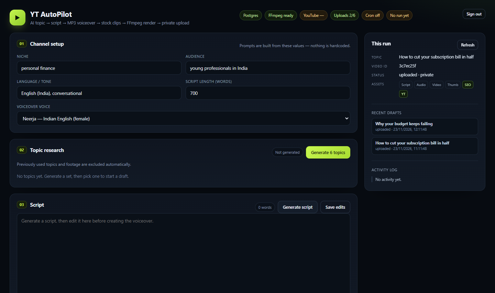
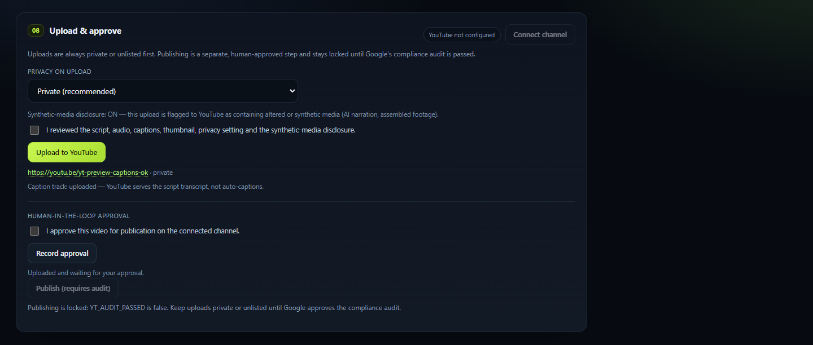

# YT AutoPilot

An end-to-end, policy-compliant YouTube pipeline: AI topic research → editable script → server-side MP3 voiceover → deduplicated Pexels footage → FFmpeg 1080p render with burned captions → SEO metadata + canvas thumbnail → **private/unlisted** YouTube upload with a human "Approve & Publish" gate.

Nothing here downloads or re-uploads third-party YouTube videos. Visuals come only from Pexels (free licence) and text/metadata from Google Gemini.

```
[Frontend: single-page studio]
        │ REST
[Fastify API]  /api/topics  /api/videos  /api/script  /api/tts
        │      /api/render  /api/status/:jobId  /api/seo
        │      /api/thumbnail  /api/upload  /api/youtube/*
        │
        ├── Gemini 2.5 Flash (topics, script, SEO)
        ├── edge-tts-universal → uploads/audio/{videoId}.mp3
        ├── Pexels /videos/search → uploads/clips/{pexelsId}.mp4
        ├── BullMQ + FFmpeg worker → uploads/videos/{videoId}.mp4 + .ass
        └── YouTube Data API v3 (OAuth 2.0, quota-guarded)
        │
[PostgreSQL]  videos · used_clips · used_topics · oauth_tokens · job_logs · render_jobs
[Redis]       BullMQ render queue
[node-cron]   daily 18:00 IST (Asia/Kolkata)
```

---

## Screenshots





From a local run against Postgres with two seeded drafts.

---

## 1. Prerequisites

- **Node.js 20.11+** (built and tested with Node 24)
- **Docker** (optional, for Postgres + Redis) or a hosted Postgres such as Supabase
- **FFmpeg** — optional: the `ffmpeg-static` / `ffprobe-static` npm packages provide binaries. To use a system FFmpeg (recommended for burned captions), set `FFMPEG_PATH` and `FFPROBE_PATH`.
- Accounts/keys: Google AI Studio (Gemini), Pexels, Google Cloud (YouTube Data API v3)

---

## 2. Quick start

```bash
# 1. Postgres + Redis
docker compose up -d

# 2. Backend
cd backend
cp .env.example .env          # then fill in the keys below
npm install
npm run migrate               # applies src/db/schema.sql (idempotent)
npm run dev                   # http://localhost:3000
```

Open <http://localhost:3000>. The UI, `/api/*` and `/uploads/*` are all served by Fastify.

Production build:

```bash
cd backend
npm run build
npm start                     # node dist/server.js
```

> If `DATABASE_URL` is empty the API starts with an **ephemeral in-memory store** so you can click through the UI without Docker. Data (including used-clip dedupe) disappears on restart, so use Postgres for anything real.

### Optional: separate worker process

Render jobs run inside the API process by default (`RUN_WORKER=true`). To isolate FFmpeg:

```bash
# terminal 1
cd backend && npm run dev

# terminal 2 (same .env)
cd backend && RUN_WORKER=false npm run dev   # API only
cd backend && npm run worker                 # BullMQ worker only
```

If Redis is unreachable, `POST /api/render` automatically falls back to inline rendering in the API process (logged as `mode: "inline"`).

---

## 3. Environment variables

All values live in `backend/.env` (loaded from the working directory). See `backend/.env.example`.

| Variable | Purpose |
| --- | --- |
| `PORT`, `HOST`, `PUBLIC_BASE_URL` | API bind + public origin used for the OAuth redirect |
| `DATABASE_URL`, `DATABASE_SSL` | Postgres/Supabase connection (set `DATABASE_SSL=true` for Supabase). **Required when `NODE_ENV=production`** — the app refuses to start without it |
| `TOKEN_ENCRYPTION_KEY` | AES-256-GCM key for the stored YouTube OAuth tokens (32 bytes: base64 or 64 hex characters). **Required when `NODE_ENV=production`** — the app refuses to start without it. Generate with `openssl rand -base64 32` and keep it out of the database |
| `REDIS_URL` | BullMQ connection; leave empty to render inline (a clear warning is logged at startup) |
| `GEMINI_API_KEY`, `GEMINI_MODEL` | Gemini 2.5 Flash (`gemini-2.5-flash` by default) |
| `TTS_PROVIDER`, `TTS_VOICE`, `TTS_RATE` | `edge` (no key) or `google`; default voice `en-IN-NeerjaNeural` |
| `GOOGLE_TTS_KEY`, `GOOGLE_TTS_VOICE` | Optional Google Cloud TTS fallback |
| `PEXELS_API_KEY` | Stock footage search |
| `YT_CLIENT_ID`, `YT_CLIENT_SECRET`, `YT_REDIRECT_URI` | OAuth 2.0 web client |
| `YT_AUDIT_PASSED` | `true` **only** after Google approves the compliance audit |
| `YT_DISCLOSE_SYNTHETIC_MEDIA` | Sends `status.containsSyntheticMedia: true` on upload and publish; keep it on (default `true`) |
| `YT_CATEGORY_ID`, `MAX_UPLOADS_PER_DAY` | Upload defaults (default 6/day quota guard) |
| `YT_CAPTION_LANGUAGE` | BCP-47 language of the caption track uploaded from the rendered `.srt` (default `en`) |
| `CAPTION_FAILURE_ALERT_THRESHOLD` | Consecutive uploads without a caption track before the admin is alerted, repeated at each further multiple (default 3) |
| `TELEGRAM_BOT_TOKEN`, `TELEGRAM_CHAT_ID` | Admin alerts (failure + draft-ready notifications). Unset, each alert is stored as an `alert` row in the activity log instead |
| `SCHEDULER_ENABLED`, `CRON_SCHEDULE`, `CRON_TIMEZONE` | node-cron daily run (18:00 Asia/Kolkata by default) |
| `PIPELINE_CATCH_UP_HOURS` | Boot catch-up threshold: run once if the newest run is older than this (default 24, match the cron period) |
| `PIPELINE_SILENT_HOURS` | No completed run for this long marks the pipeline chip bad (default 30, one daily period plus slack) |
| `DEFAULT_NICHE`, `DEFAULT_AUDIENCE`, `DEFAULT_LANGUAGE`, `DEFAULT_SCRIPT_LENGTH` | Scheduler defaults (the UI sends its own values) |
| `FFMPEG_PATH`, `FFPROBE_PATH`, `RENDER_TIMEOUT_MS` | Binary overrides + per-command timeout |

### Where the YouTube tokens live

`oauth_tokens` holds a long-lived refresh token, so the column values are encrypted with AES-256-GCM
under `TOKEN_ENCRYPTION_KEY` before they are written (`src/utils/tokenCipher.ts`). The key is only in
the environment, so a database dump or backup on its own cannot be used to reach the channel.

- **Production requires the key.** `NODE_ENV=production` without `TOKEN_ENCRYPTION_KEY` fails at
  startup instead of silently falling back to plaintext. Development and tests may omit it; new rows
  are then written unencrypted, which is fine for a local database.
- **Existing plaintext rows keep working.** Values written before the key existed have no `enc:v1:`
  prefix and are read as plaintext, so adding a key does not force a reconnect. They are encrypted on
  the next write — the next Google token refresh or a reconnect. Running `npm run migrate` does not
  rewrite them.
- **A wrong or lost key is loud, not silent.** The store refuses to return garbage: you get an error
  naming `TOKEN_ENCRYPTION_KEY`, and the fix is to restore the key or reconnect the channel at
  `/api/youtube/auth`. Rotating the key therefore means reconnecting the channel once.

```bash
openssl rand -base64 32     # TOKEN_ENCRYPTION_KEY (backend/.env, or the host's secret store)
```

### Store and queue safety

- **`NODE_ENV=production` requires `DATABASE_URL`.** Without it the app would use the in-memory
  store, losing every video, log and approval on restart and resetting the topic/clip dedupe
  ledgers. Startup fails with a message naming the missing variable instead of serving data it
  cannot keep. Development and tests keep the in-memory fallback.
- **No `REDIS_URL` renders inline** inside the API process rather than through BullMQ. That is fine
  locally, so the server logs a warning (and says so more strongly in production) because a crash,
  restart or deploy would kill the render in flight.

### Gemini

1. Create a key at <https://aistudio.google.com/apikey>.
2. Put it in `GEMINI_API_KEY`.

Requests use `POST https://generativelanguage.googleapis.com/v1beta/models/gemini-2.5-flash:generateContent` with the `x-goog-api-key` header, JSON output mode, and 3 attempts of exponential backoff.

### Pexels

1. Sign in at <https://www.pexels.com/api/> and copy your API key.
2. Put it in `PEXELS_API_KEY`.

Searches use `GET https://api.pexels.com/videos/search?query=…&per_page=…&orientation=landscape&size=medium`, results are cached for 10 minutes, and the best ≤1080p MP4 file is downloaded to `uploads/clips/{id}.mp4`.

### Edge TTS (default voiceover engine)

`edge-tts-universal` talks to Microsoft Edge's public TTS endpoint, needs no key, and returns an MP3. The backend chunks long scripts (<2800 chars per request), retries each chunk, then concatenates the parts with FFmpeg. This is the **only** audio source for the final video — browser `SpeechSynthesis` is never used because its audio cannot be captured.

If Edge TTS is unreachable and `GOOGLE_TTS_KEY` is set, Google Cloud TTS is tried automatically.

---

## 4. Google Cloud / YouTube OAuth setup

1. <https://console.cloud.google.com/> → create (or select) a project.
2. **APIs & Services → Library → YouTube Data API v3 → Enable**.
3. **OAuth consent screen** → External → add your own Google account under **Test users** (or publish the app).
4. **Credentials → Create credentials → OAuth client ID → Web application**.
   - Authorised JavaScript origin: `http://localhost:3000`
   - Authorised redirect URI: `http://localhost:3000/api/youtube/callback`
5. Copy the client ID/secret into `YT_CLIENT_ID` / `YT_CLIENT_SECRET`.
6. Restart the API, open the app, click **Connect channel**, and grant the `youtube.upload` + `youtube` + `youtube.force-ssl` scopes. The refresh token is stored in `oauth_tokens`, encrypted with `TOKEN_ENCRYPTION_KEY` (see [Where the YouTube tokens live](#where-the-youtube-tokens-live)). `youtube.force-ssl` is what `captions.insert` accepts — a channel connected before this scope was added must be reconnected once, or the caption track is silently skipped with a warning.

The callback redirects to `/?youtube=connected` (or `/?youtube=error&reason=…`). You can prove the connection with `npm run smoke:youtube` (see [Live YouTube smoke test](#live-youtube-smoke-test-opt-in)).

**Quota:** `videos.insert` costs 1,600 units of the default 10,000/day → 6 uploads maximum. The caption track adds 400 units per upload (`captions.insert`), so the six daily uploads' captions cost 2,400 of the shared 10,000. The API counts uploads from the last 24 hours and refuses to exceed `MAX_UPLOADS_PER_DAY` (hard-capped at 6). `thumbnails.set` costs 50 units.

**Compliance:** uploads are forced to `private` unless you explicitly choose `unlisted`. Publishing to `public` is a separate endpoint that requires (a) a recorded human approval and (b) `YT_AUDIT_PASSED=true`. Do not flip that flag until Google has audited your app.

---

## 5. Daily automation

Enable in `backend/.env`:

```env
SCHEDULER_ENABLED=true
CRON_SCHEDULE=0 18 * * *
CRON_TIMEZONE=Asia/Kolkata
```

Each run (`src/services/pipeline.ts`):

1. Skips if a non-failed video was created in the last 20 hours (daily dedupe).
2. Generates a fresh topic (excludes every topic already in `videos` / `used_topics`).
3. Generates the script, then the MP3, then SEO metadata.
4. Creates a BullMQ render job.
5. Sends an admin alert. **It never uploads or publishes.**

### One run at a time, and no silently missed days

Every attempt is recorded in `pipeline_runs` (`trigger_kind` = `schedule` / `boot` / `manual`,
`status` = `running` / `completed` / `skipped` / `failed`, with the video, job, reason or error), so
"did today run?" is a query instead of a guess.

Runs are serialised by an advisory lock: `pg_try_advisory_lock` on a dedicated connection in
Postgres, an in-process flag for the memory store. A cron fire, a boot catch-up and
`npm run run:daily` can therefore never generate two videos — the loser returns
`skipped: Another pipeline run is already in progress` and records nothing. The lock disappears by
itself if the process dies, and the 20-hour rule still applies inside the winner.

If the server was down at the scheduled time, the tick is simply lost. On boot with
`SCHEDULER_ENABLED=true`, `catchUpScheduledRun()` looks at the newest ledger row and starts **one**
run when it is older than `PIPELINE_CATCH_UP_HOURS` (default 24 h, so it matches a daily cron).
Startups close to the scheduled time or shortly after a normal run do nothing.

### A channel that silently stopped is visible in the header

The status chip reads the same ledger: `GET /api/health` reports `pipeline.silent` when the newest
*completed* run (the last video actually produced) finished more than `PIPELINE_SILENT_HOURS` ago —
30 hours by default, one daily period plus slack. A channel whose cron died, whose process is down,
or whose runs all fail therefore turns the chip **red** even though its last ledger row may say
`skipped`. With no ledger history at all the chip stays amber (`No run yet`): nothing has happened
yet, which is not the same as something having stopped.

Manual dry run (creates a real draft and waits for the render):

```bash
cd backend
npm run run:daily -- "personal finance" "young professionals"
```

### GitHub Actions alternative

```yaml
name: daily-video
on:
  schedule:
    - cron: "30 12 * * *" # 18:00 IST
  workflow_dispatch:
jobs:
  run:
    runs-on: ubuntu-latest
    steps:
      - uses: actions/checkout@v4
      - uses: actions/setup-node@v4
        with: { node-version: 22 }
      - run: sudo apt-get update && sudo apt-get install -y ffmpeg
      - run: npm ci
        working-directory: backend
      - run: npm run run:daily
        working-directory: backend
        env:
          DATABASE_URL: ${{ secrets.DATABASE_URL }}
          REDIS_URL: ${{ secrets.REDIS_URL }}
          GEMINI_API_KEY: ${{ secrets.GEMINI_API_KEY }}
          PEXELS_API_KEY: ${{ secrets.PEXELS_API_KEY }}
          TELEGRAM_BOT_TOKEN: ${{ secrets.TELEGRAM_BOT_TOKEN }}
          TELEGRAM_CHAT_ID: ${{ secrets.TELEGRAM_CHAT_ID }}
```

Set `RUN_WORKER=true` in that environment (or run `npm run worker` alongside) so the render job is processed.

---

## 5b. Sign-in and access control

The API can approve and publish videos, so it is never open:

- **Loopback by default.** `HOST` defaults to `127.0.0.1`; set `HOST=0.0.0.0` only if you really
  want it reachable from the network (behind a reverse proxy with TLS).
- **One shared API token.** Set `API_TOKEN` in `backend/.env`. If you don't, the server generates
  a random token on first boot and stores it in `backend/.api-token` (gitignored, mode `600`) and
  logs the path at startup. There is no unauthenticated mode.
- **Browser:** open the app and paste the token into the sign-in card. The server answers with a
  signed, `HttpOnly`, `SameSite=Strict` cookie (12 h) — the token itself is never sent to the
  browser or stored in `localStorage`.
- **Scripts:** send `Authorization: Bearer <API_TOKEN>`.

```bash
curl -s localhost:3000/api/videos -H "Authorization: Bearer $API_TOKEN"
```

Who approved what: `POST /api/videos/:id/approve` stores the approver's name in
`videos.approved_by` (from the name on the sign-in form, else `APPROVER_NAME`, else the OS user)
and writes it to the activity log. The UI shows `Approved … by <name>`.

---

## 6. API reference

| Method | Endpoint | Description |
| --- | --- | --- |
| `GET` | `/api/health` | Public. Store mode, queue mode, FFmpeg availability, scheduler, quota, newest pipeline run (trigger, status, start/finish, reason — no ids or topic), feature flags |
| `POST` | `/api/login` | Public. `{ token, name? }` → signed session cookie |
| `POST` | `/api/logout` | Public. Clears the session cookie |
| `GET` | `/api/session` | Public. `{ authenticated, approver }` |
| `POST` | `/api/topics` | `{ niche, audience, language }` → 6 deduplicated topics |
| `POST` | `/api/videos` | Create a draft `{ topic, niche?, audience?, language? }` |
| `GET` | `/api/videos` | Recent drafts (`?limit=`) |
| `GET` | `/api/videos/:id` | Draft + logs + recent render jobs |
| `PATCH` | `/api/videos/:id` | Save `script`, `topic`, `seoTitle`, `seoDescription`, `seoTags` |
| `POST` | `/api/videos/:id/approve` | Record human approval `{ approved: true }` (upload required) |
| `POST` | `/api/script` | `{ topic, niche, audience, language, length, videoId? }` → script |
| `POST` | `/api/tts` | `{ script, voice?, videoId? }` → MP3 path + duration |
| `POST` | `/api/render` | `{ videoId }` → `{ jobId, mode }` |
| `GET` | `/api/status/:jobId` | Job status, progress, stage, video, logs |
| `POST` | `/api/seo` | `{ topic, niche, videoId? }` → titles, description, tags, checklist |
| `POST` | `/api/thumbnail` | `{ videoId, image: "data:image/png;base64,…" }` |
| `GET` | `/api/youtube/auth` | Returns the consent URL (`?redirect=1` redirects instead) |
| `GET` | `/api/youtube/callback` | OAuth callback (stores tokens + channel id) |
| `GET` | `/api/youtube/status` | Connected channel, audit flag, upload quota |
| `POST` | `/api/upload` | `{ videoId, privacyStatus: private\|unlisted, confirm: true, replace? }` — idempotent; `replace: true` re-uploads deliberately |
| `POST` | `/api/youtube/publish/:videoId` | `{ confirm: true, privacyStatus }` — requires approval + audit |

Every route above except `/api/health`, `/api/login`, `/api/logout`, `/api/session` and
`/api/youtube/callback` requires a session (see [Sign-in](#5b-sign-in-and-access-control)).
The allowlist lives in `src/auth.ts`, so a new route is protected by default.

**Uploads are idempotent.** `POST /api/upload` answers `409` when the video already has a
`youtube_video_id` (send `"replace": true` to upload it again on purpose) or when an upload for that
video is already in flight, so a double-click or a retry after a timeout cannot create a second
YouTube video. The daily quota is reserved atomically in the store (`claimUploadSlot`, serialised by
a Postgres advisory lock), so concurrent requests cannot both take the last slot; the reservation is
released again when the upload fails, and becomes the recorded `uploaded_at` when it succeeds.
Exhausted quota answers `429`.

**The upload also sends the caption track.** The rendered `.srt` sidecar is uploaded with
`captions.insert` after the video exists, so the searchable transcript is the script rather than
YouTube's auto-captions. It is best effort: if the track is rejected the video stays uploaded and the
warning is logged, because failing the request would report a real upload as a failure and hand its
quota slot back.

Because it is best-effort, the outcome is kept rather than only logged: `videos.captions_uploaded`
(`NULL` = never attempted, `false` = rejected) and `videos.caption_error` (YouTube's reason) are
written with the upload, included in `GET /api/videos/:id` and shown in the review step, so a
regression stays visible after the request is gone. Repeated failures are also alerted:
`CAPTION_FAILURE_ALERT_THRESHOLD` consecutive uploads without a track (default 3) send an admin
alert, repeated at each further multiple — a caption outage does not fail anything else, so it would
otherwise be silent while YouTube serves auto-captions instead of the script.

Approval is enforced in the store layer (`backend/src/db/approval.ts`): any write to the script,
audio, render, caption, thumbnail, SEO metadata, topic or YouTube id clears `approved_at` and
`approved_by` in the same update, so an approved video must be approved again after it changes.

Errors are JSON: `{ "error": "message" }` with a matching HTTP status.

---

## 7. How the render works

`src/services/ffmpeg.ts`

1. `ffprobe` reads the MP3 duration.
2. The script is cleaned (markdown, `[00:00]` cues, stage directions removed) and grouped into ~30-word sections; each section gets a duration proportional to its word count, summing exactly to the audio length.
3. For each section, keywords are extracted, Pexels is searched, and the first **unused** clip is downloaded. `used_clips` is queried before use and written after a segment succeeds — the dedupe ledger survives restarts.
4. Each clip is looped, scaled/cropped to 1920×1080, normalised to 30 fps H.264 and cut to the section duration.
5. Segments are concatenated with the concat demuxer.
6. Captions are written as a `.ass` sidecar and burned in via libass (`subtitles` filter). The same cues and timings are written as an `.srt` sidecar too, which is what the upload sends as the caption track.
7. The MP3 is muxed in with AAC 192 kbps, `-shortest`, `+faststart` → `uploads/videos/{videoId}.mp4`.
8. Progress is written to `render_jobs` for `GET /api/status/:jobId`; every step is logged to `job_logs`.

The clip source is injectable (`clipSource` in `src/services/ffmpeg.ts`, defaulting to Pexels), which is how `test/render.test.ts` runs the whole pipeline — cut, concat, captions, mux — against locally generated lavfi clips with no API keys or network.

If the captions filter is unavailable in your FFmpeg build, the render completes without burned captions, keeps the `.ass` sidecar, and logs a warning instead of failing.

### Recovery after a crash

A render exists as a BullMQ job plus a `render_jobs` row, so a process killed mid-render would leave that row `active` forever and the video unresolved. Both entry points (`src/server.ts` and `npm run worker`) therefore call `src/services/reconciliation.ts` **before** accepting any new work:

- A `queued`/`active` job whose last heartbeat (`updated_at`, refreshed on every progress tick) is older than `RENDER_TIMEOUT_MS` is marked `failed` with `stage = 'stalled'`; its video is resolved to `failed` (finished videos are never downgraded), a `render` entry is written to the activity log, and the admin is alerted.
- Leftovers of interrupted work are deleted: `uploads/temp/render-*` scratch directories, `.part` downloads, `mp3-concat-*.txt` lists and the hidden `.yt-captions-*.ass` filter files. Rendered MP4s, voiceover MP3s, clips and thumbnails are never touched.
- An upload reserves its quota slot by stamping `uploaded_at` *before* `videos.insert` (see [Uploads are idempotent](#6-api-reference)). If the process dies mid-insert, that stamp would cost one of the day's 6 uploads for 24 hours with no video to show for it, so reservations older than the 30-minute in-flight window that never got a `youtube_video_id` are released and logged at startup.

Ctrl+C is the graceful path: the queue stops pulling jobs and the render in flight is marked `failed` with `stage = 'interrupted'` immediately, instead of waiting for the timeout on the next boot.

---

## 8. Database schema

`backend/src/db/schema.sql` (applied automatically on startup and by `npm run migrate`):

- `videos` — topic, script, asset paths, SEO, YouTube id, privacy, status (`draft`/`rendered`/`uploaded`/`published`/`failed`), approval timestamp, caption outcome (`captions_uploaded`, `caption_error`)
- `used_clips` — one row per Pexels clip id (unique) → cross-video dedupe
- `used_topics` — unique per topic (case-insensitive) → topic dedupe
- `oauth_tokens` — single rotating row with access/refresh token (AES-256-GCM encrypted with `TOKEN_ENCRYPTION_KEY`) + channel id
- `job_logs` — per-step `success`/`failed`/`warning`/`info` entries
- `render_jobs` — queue-facing status/progress for polling
- `pipeline_runs` — ledger of scheduled/boot/manual attempts (trigger, status, video, job, reason/error)

For Supabase: copy the connection string into `DATABASE_URL`, set `DATABASE_SSL=true`, then `npm run migrate`.

---

## 9. Compliance checklist

- ✅ No YouTube downloading, no re-uploading third-party videos, no reaction/compilation content.
- ✅ Footage only from Pexels (royalty-free) — plus optional AI text/metadata from Gemini.
- ✅ Unique topics and unique clips per video (database ledgers).
- ✅ Every upload is `private` or `unlisted`; publishing needs a human approval **and** a passed audit.
- ✅ Altered/synthetic content is disclosed on every upload and re-asserted when publishing (`status.containsSyntheticMedia`, per the YouTube Data API videos resource), and the review step shows whether that disclosure is on before a human approves.
- ✅ Server-side MP3 only; no `SpeechSynthesis` capture tricks.
- ✅ Every step logged, external calls retried 3× with exponential backoff, admin alerted on failure.

---

## 10. Project structure

```
yt-autopilot/
├── backend/
│   ├── src/
│   │   ├── routes/        topics, videos, script, tts, seo, thumbnail, render, upload, health
│   │   ├── services/      gemini, topic, script, seo, edgeTts, pexels, ffmpeg, youtube,
│   │   │                  thumbnail, renderService, pipeline, scheduler, alerts, jobLog
│   │   ├── workers/       renderWorker.ts
│   │   ├── db/            schema.sql, types, pgStore, memoryStore, migrate
│   │   ├── utils/         logger, retry, errors, validate, urls
│   │   ├── server.ts
│   │   └── runDaily.ts
│   ├── scripts/copy-assets.mjs
│   ├── .env.example
│   └── package.json
├── frontend/
│   ├── index.html         single-page studio
│   ├── styles.css
│   └── app.js
├── uploads/               audio · clips · videos · thumbnails · temp
├── docker-compose.yml
└── README.md
```

---

## 11. Tests

Focused tests run with no database, Redis or API keys (the runner forces `DATABASE_URL` and every key to empty, so `backend/.env` cannot leak in):

```bash
cd backend
npm test               # node:test via tsx, in-memory store
npm run typecheck:test # typechecks src + test together
```

Coverage:

- `test/buildSections.test.ts` — section splitting, exact audio-length allocation, contiguity, proportional timing, stripped timestamps/markdown.
- `test/dedupe.test.ts` — clip ledger idempotency, case-insensitive topic ledger, near-duplicate detection, 6 unique topics even when a fallback topic is already used.
- `test/quota.test.ts` — rolling 24-hour upload count and the guard that stops `videos.insert` at 6 uploads/day.
- `test/captionAlert.test.ts` — the caption failure streak (newest-first, ended by a success, legacy NULL rows skipped) and the alert threshold/multiples.
- `test/tokenCipher.test.ts` — AES-256-GCM round-trip, fresh IVs, tamper/wrong-key rejection, plaintext legacy values, key parsing (hex/base64) and the production key guard.
- `test/publish.test.ts` — HTTP-level gates: confirm flag, upload required, human approval required, `YT_AUDIT_PASSED` required, approval requires an upload, upload requires confirmation.

### PostgreSQL integration suite

`npm test` always uses the in-memory store, so PgStore needs its own run against a real server:

```bash
docker compose up -d postgres   # from the repository root; wait for "healthy"
cd backend && npm run test:db
```

`scripts/run-db-tests.mjs` connects to `DATABASE_URL` (default `postgresql://yt:yt@localhost:5432/yt_autopilot`),
drops and recreates a throwaway `yt_autopilot_test` database, points the suite at it and runs
`test/db.test.ts`. The development database is never touched, and the suite refuses to run against
a database whose name does not end in `_test`.

It covers what the memory store cannot: the non-UUID guard (`invalid input syntax for type uuid` →
404), the `used_topics_topic_key` unique index on `lower(topic)` that `ON CONFLICT (lower(topic))`
depends on, `NOT NULL`/`CHECK` constraints, `ON DELETE CASCADE`/`SET NULL`, the `updated_at`
triggers, `TEXT[]` and `timestamptz` round-tripping, the approval rule in real SQL, and the approve
route writing `approved_by` through PgStore.

Use a different throwaway name with `PG_TEST_DATABASE=yt_autopilot_test2 npm run test:db`.

#### Running it without Docker

Docker is optional — the suite only needs any reachable PostgreSQL 16 server. The commands below use
EDB's portable Windows binaries unpacked into `.ci/pgsql` with a data directory at `.ci/data`
(`.ci/` is gitignored); this is the setup the suite was actually verified against.

```bash
# from the repository root, once
.ci/pgsql/bin/initdb.exe -D .ci/data -U postgres -A trust
.ci/pgsql/bin/pg_ctl.exe -D .ci/data -o "-p 55432 -h 127.0.0.1" -l .ci/pg.log start

# point the runner at that cluster instead of the compose default
cd backend
DATABASE_URL=postgresql://postgres@127.0.0.1:55432/postgres PG_TEST_DATABASE=yt_autopilot_test npm run test:db
cd ..

# stop it when you are done
.ci/pgsql/bin/pg_ctl.exe -D .ci/data stop
```

`DATABASE_URL` here is only the admin connection used to create the throwaway database — it does not
need to be the app database, so any superuser role and database will do (the example uses the
`postgres` database on port 55432 to avoid clashing with a system server on 5432). `PG_TEST_DATABASE`
must end in `_test`, is dropped and recreated on every run, and defaults to `yt_autopilot_test` when
omitted. On macOS/Linux drop the `.exe` suffixes (`bin/initdb`, `bin/pg_ctl`); the rest is identical.

### Live YouTube smoke test (opt-in)

Everything above runs offline and without keys. The one thing a fake client cannot prove is the real
YouTube path, so it has its own opt-in script:

```bash
cd backend
npm run smoke:youtube
```

It reads the connected channel's stored OAuth tokens (`DATABASE_URL` + `/api/youtube/auth`) and:

1. generates a 3-second 640×360 MP4, a 1280×720 PNG and a real `.srt` via `buildSections` + `writeSrtFile`;
2. uploads it **private** through `uploadToYouTube` — the same function `POST /api/upload` uses — with
   the thumbnail and the caption sidecar;
3. checks the result flags, then verifies the track exists with `captions.list` (language, name, status);
4. deletes the video again, even when a check failed.

It skips with exit code 0 and a `SKIP` line when `YT_CLIENT_ID`/`YT_CLIENT_SECRET`, `DATABASE_URL` or the
stored channel tokens are missing, and it is never part of `npm test`. It does not create a `videos` row
or spend one of the 6 daily upload slots, but it does spend real API quota — one `videos.insert`, one
`thumbnails.set`, one `captions.insert` and one `captions.list` (roughly 2,050 of the 10,000 daily units).
Run it once after connecting a channel or changing OAuth scopes, not in a loop. If the delete is
rejected, the video id and its Studio link are printed so you can remove it by hand.

### Continuous integration

`.github/workflows/ci.yml` runs on every push and pull request and needs no local Docker: it starts a
`postgres:16-alpine` service, then runs `npm run typecheck`, `npm run typecheck:test`, `npm run build`,
`npm test` and `npm run test:db` in `backend/`.

It also installs FFmpeg plus the caption fonts (`fonts-dejavu-core`, `fonts-liberation`) and fails early
if the FFmpeg build has no libass `subtitles` filter — otherwise `test/render.test.ts` could report a
captionless render as a pass. `FFMPEG_PATH`/`FFPROBE_PATH` point at the distro binaries there, because
they are built with libass and fontconfig.

## 12. Troubleshooting

| Symptom | Fix |
| --- | --- |
| `FFmpeg could not be started` | Install FFmpeg or set `FFMPEG_PATH`/`FFPROBE_PATH`; re-run `npm install` so `ffmpeg-static` downloads its binary |
| Render fails on `subtitles` filter | Your FFmpeg build lacks libass. Use a full build (e.g. `gyan.dev` on Windows, `apt install ffmpeg` on Linux). Renders still succeed without burned captions |
| `EADDRINUSE :3000` | Change `PORT` or stop the other process |
| Topic/script calls return 503 | `GEMINI_API_KEY` is missing; topic generation falls back to templates, script/SEO need the key |
| Pexels 401 | Check `PEXELS_API_KEY` |
| Edge TTS network error | The endpoint needs outbound WSS access; set `TTS_PROVIDER=google` + `GOOGLE_TTS_KEY` as a fallback |
| YouTube 403 `quotaExceeded` | Daily quota is 10,000 units (≈6 uploads). Wait for the Pacific-time reset |
| `Publishing is locked` | Expected: `YT_AUDIT_PASSED` is false. Uploads stay private/unlisted until Google audits the app |
| Supabase SSL error | Set `DATABASE_SSL=true` |
| Memory DB warning | `DATABASE_URL` is unset; start Postgres (`docker compose up -d`) for durable dedupe |
